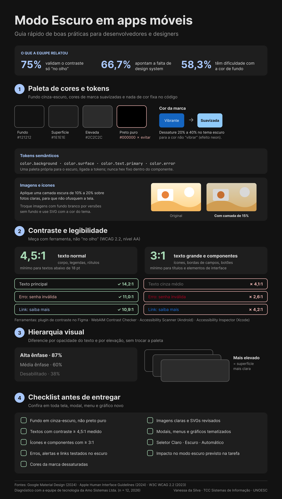

# TCC-Modo-Escuro-em-Interfaces-Moveis

**Modo Escuro em Interfaces Móveis: diagnóstico de desenvolvimento e proposta de heurísticas visuais**

Trabalho de Conclusão de Curso de Vanessa da Silva, no curso de Sistemas de Informação da Universidade do Oeste de Santa Catarina (UNOESC), Campus de Chapecó. Orientador: Prof. Jean Carlos Hennrichs. 2026.

## Sobre a pesquisa

A pesquisa analisou como uma equipe real de desenvolvimento implementa o Modo Escuro em aplicativos móveis e comparou essas práticas com as recomendações da literatura (Material Design, Apple Human Interface Guidelines e WCAG 2.2). Foi feito um estudo de caso censitário com os 12 profissionais de tecnologia da Amo Sistemas Ltda. Com base nos resultados, foi desenvolvido um infográfico de boas práticas, verificado com um checklist de conformidade técnica.

Principais resultados do diagnóstico:

- 75% da equipe valida o contraste apenas visualmente, sem ferramenta de medição;
- 66,7% atribuem as inconsistências visuais à ausência de um design system;
- 58,3% apontam a escolha da cor de fundo como o principal obstáculo à legibilidade.

## Arquivos

| Arquivo | Conteúdo |
| --- | --- |
| [TCC1-VanessaDaSilva.pdf](TCC1-VanessaDaSilva.pdf) | Projeto de pesquisa (TCC I), revisado após a banca, com os resultados do questionário. |
| [Artigo-TCC2-VanessaDaSilva.pdf](Artigo-TCC2-VanessaDaSilva.pdf) | Artigo científico final (TCC II), no modelo da UNOESC. |
| [infografico-modo-escuro-VanessaDaSilva.png](infografico-modo-escuro-VanessaDaSilva.png) | Infográfico de boas práticas para o Modo Escuro, desenvolvido no Figma e validado com o plugin Stark. |

## Infográfico

